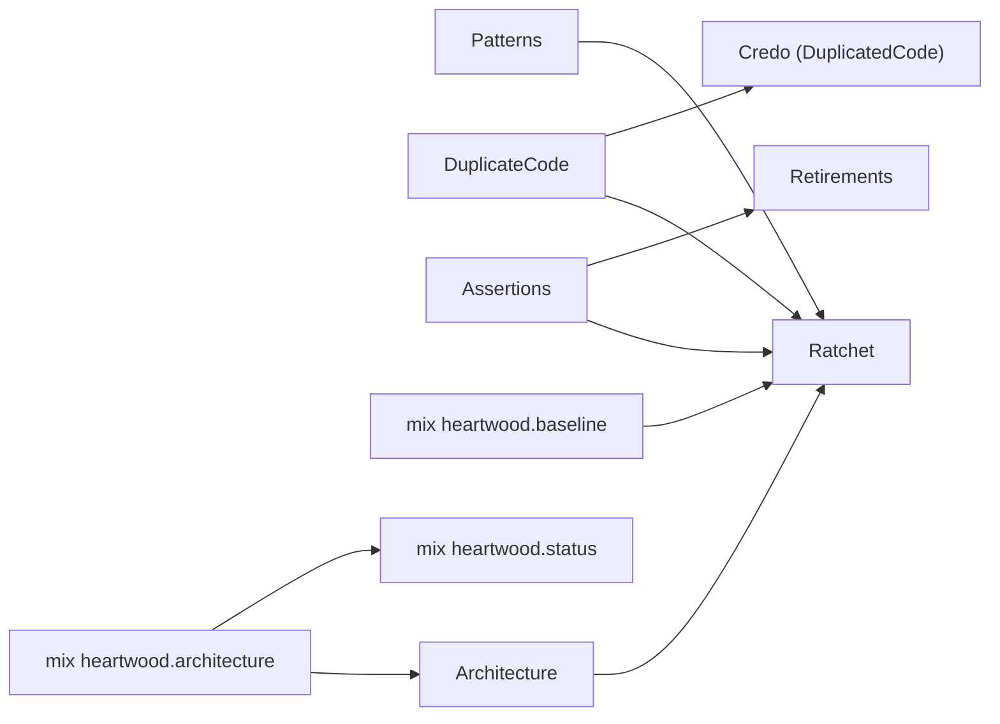

# Architecture

Heartwood's architecture as built: what its packages are made of and how the parts connect. It describes only what exists; it changes in the same commit as the code that changes it. The rules the code must follow are in [rules.md](rules.md), and the periodic architecture reviews in [reviews.md](reviews.md). Why heartwood exists, and how changes flow to the apps, is in the [root README](../../README.md) and Oak Compendium's `docs/architecture/decisions.md` (2026-11-26).

## Packages

One package so far, `heartwood_guardrails` in `guardrails/`: a Mix project that apps depend on as a git dependency, `only: [:dev, :test], runtime: false`, pinned by tag and fetched with `sparse: "guardrails"`. Mix checks it out at `deps/heartwood_guardrails/guardrails` in the app. `heartwood_ui` is planned. Neither may depend on an app: anything app-specific reaches heartwood as a setting or an argument.

## heartwood_guardrails

- **Ratchets.** `Heartwood.Guardrails.Ratchet` holds counts to a JSON baseline in the app and fails both ways. `Patterns` builds one from an app's rules (a pattern per line, or a counting function, per file); `DuplicateCode` counts copied code with Credo's `DuplicatedCode` check, run with the app's `duplicates` config. `Assertions` gives the app's tests `assert_ratchet/1` and `assert_no_outstanding_retirements/0`; `mix heartwood.baseline` writes a baseline.
- **Retirements.** `Retirements` reads the app's list of modules being replaced and finds the ones whose old module still exists.
- **Git hooks** (`hooks/`, shell). The app copies `hooks/app-shim` to its `dev/githooks/pre-commit` and `pre-push`; `hooks/install` puts wrappers in git's hooks directory that run them. The shim runs heartwood's `hooks/pre-commit` (the commit gate: a passing reuse review of the staged tree) or `hooks/pre-push` (the push guard: no force pushes, no pushes to main), and blocks when heartwood is missing.
- **The reuse review** (`bin/review-packet`, `bin/record-review`, `review/reviewer.md`): a packet of the staged change for a reviewer with fresh context, and its verdict, kept in `<git dir>/<app>-review/<tree>.md`, which the commit gate reads.
- **The architecture review** (`mix heartwood.architecture`, `Architecture`, `bin/record-architecture`, `review/architect.md`): a periodic review of the whole repository against its architecture docs, by several models. The packet holds the commits since the last change to `reviews.md`, the `mix xref` graph folded to contexts, every ratchet against its baseline and `mix heartwood.status`; reports are kept in `<git common dir>/<app>-architecture/<run>/<model>.md`.
- **`bin/check-toolchain`** (shell): the app's Dockerfiles against the Nix dev shell.
- **`mix heartwood.status`**: each heartwood package's pinned tag against the latest, from `git ls-remote`.
- **Settings.** The shell scripts and `Architecture` read the app's `dev/guardrails/config.sh` (the package README lists the settings); the Elixir modules read `config :heartwood_guardrails`.

## Delivery

- **Toolchain:** a Nix flake (Elixir 1.19, OTP 28, Node), the same versions as both apps, loaded by direnv.
- **Checks:** `make done-checks` runs each package's `mix precommit` (format, compile with warnings as errors, `credo --strict`, unused deps, tests), Dialyzer and the security audits. CI runs the same, plus CodeQL; Dependabot groups updates into one PR per ecosystem; every workflow's token is read-only, and a ruleset on main requires every check.
- **Hooks:** heartwood runs its own commit gate and push guard, installed from its source tree (`make hooks`; `HEARTWOOD_HOME=guardrails`).
- **Releases:** tags `v0.y.z` on main after Jeff merges, with a CHANGELOG.md entry per package; apps move to a tag when they choose.
