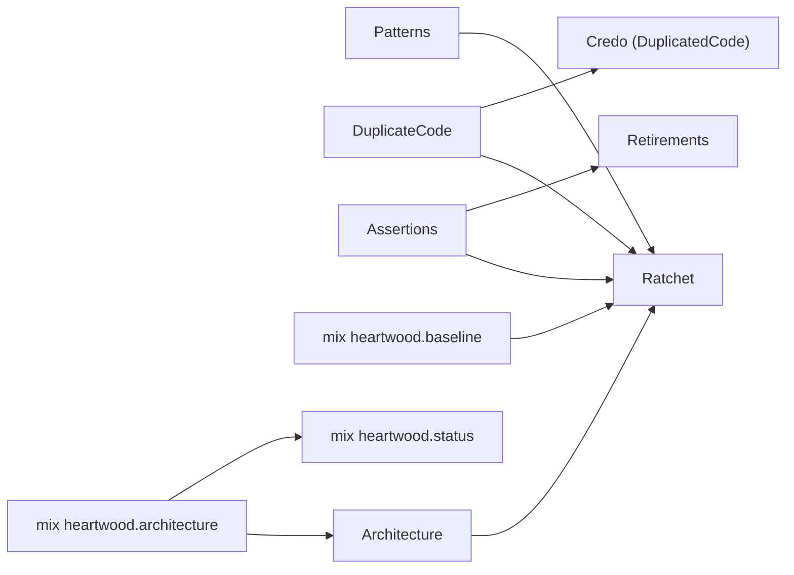
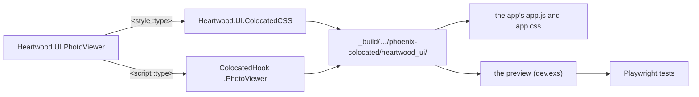

# Architecture

Heartwood's architecture as built: what its packages are made of and how the parts connect. It describes only what exists; it changes in the same commit as the code that changes it. The rules the code must follow are in [rules.md](rules.md), and the periodic architecture reviews in [reviews.md](reviews.md). Why heartwood exists, and how changes flow to the apps, is in the [root README](../../README.md) and Oak Compendium's `docs/architecture/decisions.md` (2026-11-26).

## Packages

Two packages, each a Mix project in its own folder that apps depend on as a git dependency, pinned by tag and fetched with `sparse:` (Mix checks it out at `deps/<package>/<folder>` in the app):

- `heartwood_guardrails` in `guardrails/`, `only: [:dev, :test], runtime: false`.
- `heartwood_ui` in `ui/`, a runtime dependency.

Neither may depend on an app: anything app-specific reaches heartwood as a setting, an argument or a custom property.

## heartwood_guardrails

- **Ratchets.** `Heartwood.Guardrails.Ratchet` holds counts to a JSON baseline in the app and fails both ways. `Patterns` builds one from an app's rules (a pattern per line, or a counting function, per file); `DuplicateCode` counts copied code with Credo's `DuplicatedCode` check, run with the app's `duplicates` config. `Assertions` gives the app's tests `assert_ratchet/1` and `assert_no_outstanding_retirements/0`; `mix heartwood.baseline` writes a baseline.
- **Retirements.** `Retirements` reads the app's list of modules being replaced and finds the ones whose old module still exists.
- **Git hooks** (`hooks/`, shell). The app copies `hooks/app-shim` to its `dev/githooks/pre-commit` and `pre-push`; `hooks/install` puts wrappers in git's hooks directory that run them. The shim runs heartwood's `hooks/pre-commit` (the commit gate: a passing reuse review of the staged tree, unless the change is only prose, as `hooks/prose.sh` decides; heartwood's CI uses the same file) or `hooks/pre-push` (the push guard: no force pushes, no pushes to main), and blocks when heartwood is missing.
- **The reuse review** (`bin/review-packet`, `bin/record-review`, `review/reviewer.md`): a packet of the staged change for a reviewer with fresh context, and its verdict, kept in `<git dir>/<app>-review/<tree>.md`, which the commit gate reads.
- **The architecture review** (`mix heartwood.architecture`, `Architecture`, `bin/record-architecture`, `review/architect.md`): a periodic review of the whole repository against its architecture docs, by several models. The packet holds the commits since the last change to `reviews.md`, the `mix xref` graph folded to contexts, every ratchet against its baseline and `mix heartwood.status`; reports are kept in `<git common dir>/<app>-architecture/<run>/<model>.md`.
- **`bin/check-toolchain`** (shell): the app's Dockerfiles against the Nix dev shell.
- **`bin/changes` and `actions/changes`** (shell, a composite action): which parts of a pull request are code, by package area, so CI skips the jobs it doesn't need; what counts as prose is `hooks/prose.sh`, shared with the commit gate.
- **`mix heartwood.status`**: each heartwood package's pinned tag against the latest, from `git ls-remote`.
- **Settings.** The shell scripts and `Architecture` read the app's `dev/guardrails/config.sh` (the package README lists the settings); the Elixir modules read `config :heartwood_guardrails`.

## heartwood_ui

- **Components** are function components that use only `Phoenix.Component`. Each carries its hook in a colocated `<script :type={Phoenix.LiveView.ColocatedHook}>` and its CSS in a colocated `<style :type={Heartwood.UI.ColocatedCSS}>` (global CSS, extracted as it is). The CSS uses the component's own class prefix (`pv-`) in `@layer components` and reads only its own custom properties (`--pv-*`), each with a neutral default; the markup has no Tailwind utilities. Words are labels with defaults (`labels`), and the app's own controls come in through slots (`:actions`). Layout follows the component's own width, by container queries.
- **Delivery to an app**: LiveView's compiler (in the package's `compilers`) writes the hooks and CSS to `_build/$MIX_ENV/phoenix-colocated/heartwood_ui/` with an `index.js` (exporting `hooks`) and a `colocated.css`, however the package was fetched. The app imports both through `NODE_PATH`, themes each component with one adapter block mapping its tokens onto the custom properties, and wraps it in its own component.
- **The preview** (`ui/dev.exs`, `mix dev`), after phoenix_live_dashboard's: a throwaway endpoint, router and LiveView showing each component in every state, neutral or in the two apps' themes (fixture adapter blocks in `ui/dev/preview.css`), at the widths the apps use. Its photos are Oak Compendium's, at their own URLs, or generated SVGs (`PREVIEW_PHOTOS=local`). esbuild (the Hex package) bundles it; there's no Tailwind in heartwood.
- **Tests**: ExUnit for the server-rendered markup; Playwright (`ui/test/browser/`, Chromium) against the preview with generated photos for what needs layout and the hook: the filmstrip, the position, the stage's ratio by width, moving, the full view's pan and zoom, the dialogs.

## Delivery

- **Toolchain:** a Nix flake (Elixir 1.19, OTP 28, Node), the same versions as both apps, loaded by direnv.
- **Checks:** `make done-checks` runs each package's `mix precommit` (format, compile with warnings as errors, `credo --strict`, unused deps, tests), Dialyzer and the security audits (`npm audit` too for `ui/`'s test tools), and `heartwood_ui`'s browser tests. CI runs the same, plus CodeQL, skipping a package's jobs on a pull request that doesn't touch its code (`guardrails/actions/changes`, with `HEARTWOOD_CI_AREAS`: the commit gate's prose (`HEARTWOOD_PROSE`, every Markdown file and `LICENSE`, by `guardrails/hooks/prose.sh`, less `HEARTWOOD_CODE`, the reviewers' instructions) touches nothing, and files outside the packages touch both; a skipped job satisfies its required check, so if the classifier fails, every job runs; heartwood's workflows run main's classifier, so a pull request's changes to the classifier's code never decide what runs, and a change to the settings runs everything); Dependabot groups updates into one PR per ecosystem; every workflow's token is read-only, and a ruleset on main requires every package check (not the classifier jobs, which run every job when they fail).
- **Hooks:** heartwood runs its own commit gate and push guard, installed from its source tree (`make hooks`; `HEARTWOOD_HOME=guardrails`).
- **Releases:** tags `v0.y.z` on main after Jeff merges, with a CHANGELOG.md entry per package; apps move to a tag when they choose.
